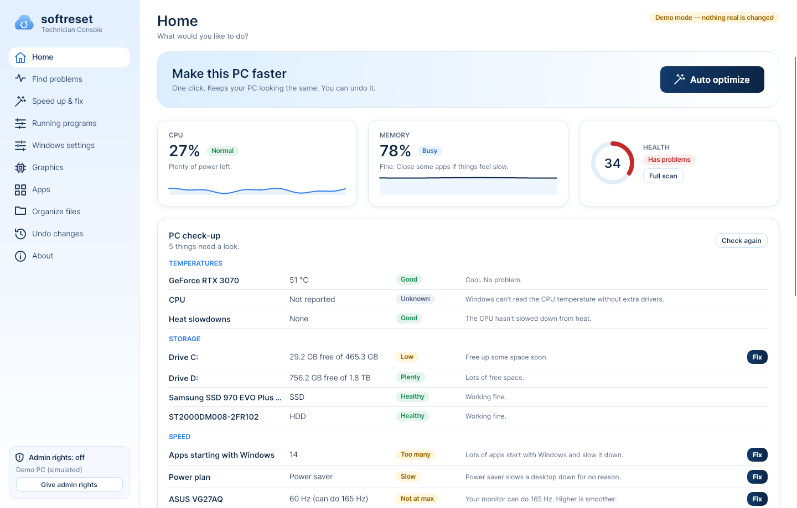

# softreset Technician Console

A portable Windows 10/11 desktop application for PC service technicians. Plug in a USB drive, run one
`.exe`, diagnose the customer's PC with real measurements, explain what you found, get the customer's
approval for each fix, apply it with a backup, measure the result, and hand over a professional PDF
report. It needs no installer, account, subscription, internet connection, background service, or
startup entry.



## Download and run

1. Download `SoftResetConsole-win-x64` from the latest successful
   [Windows build and validation](../../actions/workflows/windows-validation.yml) run (Actions → run →
   *Artifacts*). It is built and tested on a real Windows machine by that workflow.
2. Unzip it anywhere — a USB drive, the Desktop, `C:\Tools`. It is one file: `SoftResetConsole.exe`
   (about 56 MB; the .NET runtime is bundled, nothing else needs installing).
3. Double-click `SoftResetConsole.exe`. It starts with standard rights. When a change needs
   administrator rights, Windows shows its own UAC prompt for that one change.

Windows SmartScreen may warn that the file is from an unknown publisher because the executable is not
code-signed. Choose **More info → Run anyway**, or sign it with your own certificate (see
[Known limitations](docs/LIMITATIONS.md)).

### Command-line options

| Option | Purpose |
|---|---|
| *(none)* | Normal use on the PC it runs on. |
| `--demo` | Runs against a built-in simulated customer PC (gaming desktop with real-world problems). Nothing on the actual PC is read or changed. Good for training and for trying the workflow. |
| `--data <folder>` | Store records in a specific folder instead of the default. |
| `--self-test <folder>` | Runs every read-only check against this PC, writes `self-test.log`/`.json`, a snapshot, the findings, a diagnostic PDF and a settings read-out, then exits (0 = all passed). Changes nothing. |
| `--capture-pages <folder>` | Opens every page read-only, saves a screenshot of each, then exits. Changes nothing. |

## What it does

| Area | Summary |
|---|---|
| **Customer session** | A 10-step guided workflow: start → concerns → diagnose → baseline → select fixes → customer approval checklist → apply → re-check → before/after PDF report → close. Every change made during a session is linked to it. |
| **Diagnostics** | Read-only collection of performance counters, event logs (unexpected shutdowns, blue screens, WHEA, app crashes, GPU driver timeouts, service failures, boot performance), storage and disk health, drivers and device problems, Windows Update history, startup items, power and security configuration, network, displays and GPUs. **35 rules** turn the data into findings, each with evidence, likely causes, a confidence level with its reason, uncertainties, and recommended actions. |
| **Background processes** | Every process with publisher, Authenticode signature (embedded and catalog), CPU, memory, startup/service association, and knowledge of **139 common processes**. Look-alike names, unsigned programs in temp/AppData roots, and similar signals are shown as "worth investigating" — never as a malware verdict. Critical Windows processes cannot be ended. |
| **Settings explorer** | **245 Windows settings in 30 categories** (System … Group Policy, Legacy Control Panel, Administrative tools). Each has a description, current value (read from the registry, a service, a scheduled task, or a Windows API), available values, recommendations by use case, performance effect, risks, admin/restart requirements, rollback instructions, and a working control. 100 can be changed in place (backed up and reversible); the others open the exact Windows page, because Windows does not expose them programmatically. Settings not available on this Windows build or edition are hidden or marked. |
| **Graphics & NVIDIA** | GPUs with driver versions and live telemetry (NVML for NVIDIA, D3DKMT adapter data otherwise), displays and their supported refresh rates, and **54 explained driver settings** (30 NVIDIA, 17 AMD, 7 Intel). Current NVIDIA global values and per-game profiles are read from the driver through NVIDIA's public NVAPI, in a separate process. Driver settings are never written; the console opens the NVIDIA/AMD/Intel software to change them. |
| **Applications** | Desktop programs, Store apps, and optional features, with **53 detailed guides** (Discord, Spotify, Steam, Chrome, Edge, Teams, OneDrive, game launchers, peripheral software, antivirus, runtimes …): purpose, startup behaviour, common problems and fixes, repair/reset, safe uninstall, official links. Uninstalling always uses the program's own uninstaller; Windows components and shared runtimes are never offered for removal. |
| **Optimization** | **40 actions** in ten categories (startup, storage cleanup, background activity, power, gaming, display, Windows maintenance, app maintenance, network, desktop). Every action: inspect → explain benefit and risk → preview each value from → to → explicit approval → backup → apply → verify → rollback. Actions report "not applicable" when they wouldn't help. Three further internal actions apply the Settings explorer's registry, service, and scheduled-task changes through the same pipeline. |
| **File organizer** | Folder analysis, byte-for-byte duplicate detection, organisation by type/date with a full preview. Files are moved, never deleted; duplicates go to a `_softreset_review` folder; every batch can be undone. System and program folders are refused. |
| **Change history** | Every change with its backups, verification result, and one-click rollback. Changes interrupted by a crash or power loss are detected at the next start. |
| **Data & about** | Where records are stored, how big they are, and a typed-confirmation button that removes all application data. |

More screenshots: [diagnostics](docs/screenshots/02-diagnostics.png) ·
[processes](docs/screenshots/05-processes.png) · [settings](docs/screenshots/06-settings-explorer.png) ·
[graphics](docs/screenshots/07-graphics.png) · [NVIDIA](docs/screenshots/08-nvidia.png) ·
[apps](docs/screenshots/09-apps.png) · [optimization](docs/screenshots/10-optimization.png) ·
[approval](docs/screenshots/11-approval-dialog.png) · [files](docs/screenshots/12-files.png) ·
[history](docs/screenshots/13-history.png) · [session approval](docs/screenshots/19-session-approval.png) ·
[before/after](docs/screenshots/21-session-recheck.png) · [sample PDF report](docs/sample-session-report.pdf)

## Safety model

- **Diagnostics never change anything.** Inspection and preview of actions are read-only too.
- **Nothing changes without approval.** The approval dialog lists every value that will change and
  stays disabled until the technician ticks that the customer approves. Customer sessions also record
  who approved which changes.
- **Write-ahead journal.** Before anything is touched, a change record is written; backups are added as
  they are captured; the record is updated after applying and after verification. If the console is
  interrupted, the next start flags the change as interrupted and its backups remain available.
- **Honest reversibility.** Each action is labelled *Reversible*, *Partly reversible*, or *Not
  reversible* (e.g. deleting temporary files) before approval. Rollback restores exactly what was
  captured, including "this value did not exist".
- **Administrator rights per action.** The console runs as a standard user. An approved admin change is
  executed by a second copy of the same executable, started through Windows' own UAC prompt, which
  performs only that one change. Declining UAC cancels cleanly.
- **Display changes** are tested by Windows first and revert automatically after 15 seconds unless the
  technician confirms the picture.
- **Never done:** disabling Defender, the firewall, UAC, SmartScreen or Windows Update; blanket service
  disabling; "debloat" scripts; FPS-boost placebo tweaks; ending critical Windows processes; removing
  Windows components; deleting user files; classifying a process as malware.
- **Minimal customer data.** Only what's needed to identify the job is recorded; free-text fields warn
  if something looks like a password or card number.

## Where data is stored

By default the console writes to a `softreset-data` folder next to the executable (portable mode). If
that folder can't be written (e.g. a read-only location), it uses `%LOCALAPPDATA%\softreset-console`.
Nothing else is written to the PC except the changes you approve, System Restore points you request,
and `_softreset_review` folders the file organizer creates inside customer folders. *Data & about →
Remove all data* deletes everything the console stored.

## Documentation

- [Feature inventory and verification status](docs/FEATURES.md)
- [Testing and results](docs/TESTING.md)
- [Known limitations and what still needs validation on Windows](docs/LIMITATIONS.md)
- [Architecture and building from source](docs/ARCHITECTURE.md)

## Building from source (optional)

You don't need to build anything to use the console. To build it yourself, install the .NET 10 SDK and run:

```bash
dotnet test SoftReset.sln
```

```bash
dotnet publish src/SoftReset.App/SoftReset.App.csproj -c Release -r win-x64 -o dist/SoftResetConsole
```

The Windows executable can be built on Windows, macOS or Linux.
