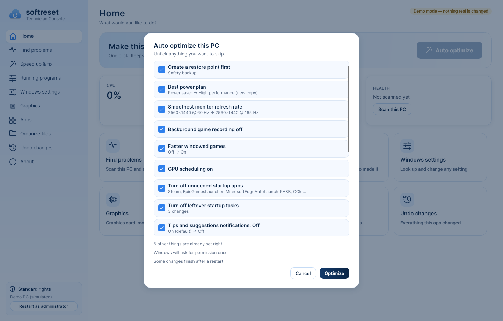

# softreset Technician Console

A portable Windows 10/11 tool for fixing PCs. Run one `.exe` — no install, no account, no internet needed.

## Get it

1. Download `SoftResetConsole-<version>-win-x64.zip` from the [latest release](../../releases/latest).
2. Unzip it anywhere (a USB stick is fine).
3. Double-click `SoftResetConsole.exe`.

If Windows says "unknown publisher", click **More info → Run anyway** (the app isn't code-signed yet).

Want to try it without touching the PC? Run `SoftResetConsole.exe --demo`.

## The easy way: Auto optimize

Click **Auto optimize** on the Home page. It checks the PC, shows a short ticked list, and applies everything that helps:

- best power plan and CPU at full speed
- your monitor's smoothest refresh rate (e.g. 60 → 144 Hz)
- Game Mode, GPU scheduling, faster windowed games, background game recording off
- unneeded apps stopped from starting with Windows (launchers, helpers, leftovers)
- temporary files cleaned, Windows tips and ads turned off

It keeps your PC looking the same. Animations are only reduced if the PC is too weak for them (under 6 GB RAM or 2 CPU threads). It makes a restore point first, asks Windows for permission once, and has an **Undo all** button. It never touches antivirus, Windows Update, your files, chat apps, cloud sync, drivers, or mouse/keyboard/RGB software.

Every page also has its own one-click button, and every problem and setting has an **Apply/Fix** or **Open** button.

## What each part does

| Page | What it's for |
|---|---|
| **Find problems** | Scans the PC and lists what's wrong, with a fix button where there is one. Changes nothing. |
| **Speed up & fix** | Pick a fix (startup apps, free up space, power plan, repair Windows, network reset…). You see exactly what changes, then click Apply. Most fixes can be undone. |
| **Running programs** | What's running, how much it uses, and who made it. |
| **Windows settings** | Search any of 245 Windows settings, see what it does, and change it. |
| **Graphics** | Graphics card, monitors and refresh rate, plus NVIDIA/AMD/Intel driver settings explained. |
| **Apps** | Installed programs with fixes for common problems, repair, and uninstall. |
| **Organize files** | Sort a messy folder and find duplicate files. Nothing is deleted. |
| **Undo changes** | Everything the app has changed. Click one to undo it. |
| **About** | Where the app keeps its data, and a button to delete it. |

## Safe by design

- Scanning never changes anything.
- Every change shows a preview and needs you to tick "Yes, make this change".
- Settings are backed up first, so changes can be undone from **Undo changes**.
- It never turns off antivirus, the firewall or Windows Update, and never deletes your files.
- It only asks for admin rights when a specific change needs them.

## More detail

- [What's been tested](docs/TESTING.md) · [Feature list](docs/FEATURES.md) · [Known limitations](docs/LIMITATIONS.md) · [How it's built](docs/ARCHITECTURE.md)
- To publish a new version: Actions → **Release** → Run workflow, enter a version like `1.0.2`.
